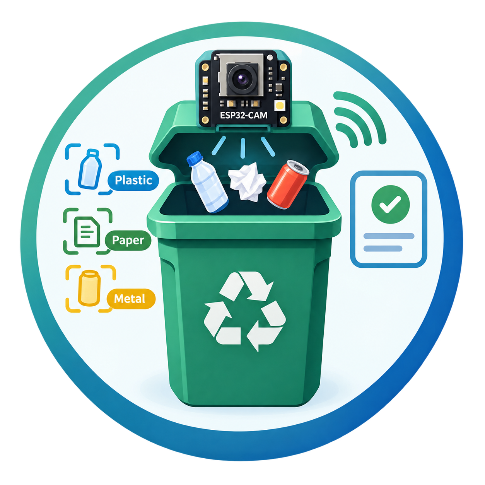
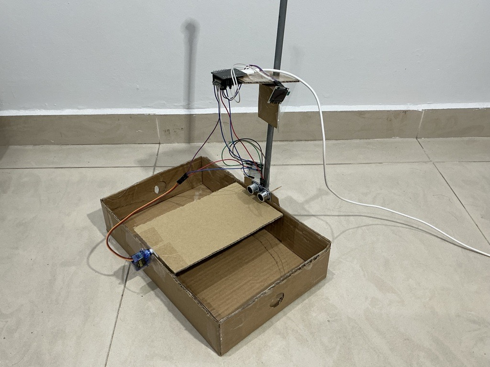
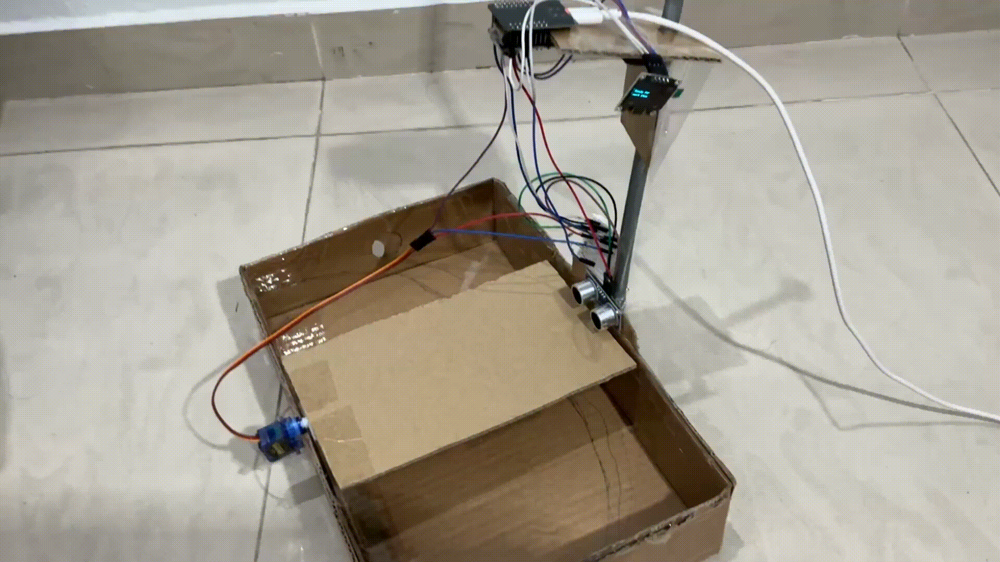

<div align="center">
    
    <h1>ESP32-CAM Smart Bin</h1>
    <h3><em>An ESP32-CAM powered automated waste disposal device.</em></h3>
</div>

<p align="center">
    <strong>Drop it in. The bin decides. An AI-powered smart bin that sorts all of your rubbish on its own.</strong>
</p>

<p align="center">
  
  
  
</p>

<p align="center">
  
  
</p>

---

# 📖 What is the ESP32-CAM Smart Bin?

**The ESP32-CAM Smart Bin can literally sort all of your rubbish.** You don't need to know what goes where. Just drop any item in, and the bin sorts it into one of two compartments: **recyclable items** or **residual waste**.

Here is what happens every time you drop something in:

1. 📏 **It notices the item.** An ultrasonic sensor sees that something has landed in the chamber.
2. 📸 **It takes a photo.** The ESP32-CAM photographs the item.
3. 🧠 **It identifies the item.** Gemini AI looks at the photo and works out what the item is (for example, "Plastic bottle"), whether it is recyclable, roughly how much it weighs, and its estimated CO₂ cost.
4. 🔀 **It sorts the item.** A servo tilts the flap so the item drops into the **recyclable** or the **residual** compartment.
5. 📟 **It shows you the result.** The OLED screen displays what the item was, its estimated weight, and its estimated CO₂ cost.

There's no PC, app, or server involved. All it needs is power and WiFi.

### What the screen shows

```
┌──────────────────────┐
│    Plastic bottle    │  ← what the item is
│──────────────────────│
│ Weight: ~25 g        │  ← estimated weight
│ CO2:    ~83 g        │  ← estimated CO2 cost (the item's carbon footprint)
│█████ RECYCLABLE █████│  ← the compartment it was sorted into
└──────────────────────┘
```

### What goes where

| The AI recognises the item as... | Sorted into |
|---|---|
| Glass | ♻️ Recyclable |
| Milk / drink carton | ♻️ Recyclable |
| Cardboard / paper | ♻️ Recyclable |
| Metal | ♻️ Recyclable |
| Plastic | ♻️ Recyclable |
| Aluminium can | ♻️ Recyclable |
| Anything non-recyclable or heavily contaminated (food waste, tissues, ...) | 🗑️ Residual |
| Nothing recognisable / the AI can't be reached | 🗑️ Residual (the bin plays it safe) |

> 💡 The weight and CO₂ figures are **AI estimates** based on what the item looks like. The bin has no scale.

---

# 📸 Product Preview

<div align="center">
  <table>
    <tr>
      <th>The Smart Bin</th>
      <th>Sorting a Recyclable Item</th>
      <th>Sorting Residual Waste</th>
    </tr>
    <tr>
      <td align="center"></td>
      <td align="center"></td>
      <td align="center"></td>
    </tr>
  </table>
</div>

---

# 🛠️ Step-by-Step Configuration Guide

Follow these steps in order. **No previous electronics or programming experience is needed.**

## STEP 1: Get the parts

| Part | Notes |
|---|---|
| **ESP32-CAM** (AI-Thinker, with PSRAM) + **ESP32-CAM-MB** motherboard | The brain and the camera. The motherboard adds a USB port for uploading code. |
| **HC-SR04** ultrasonic sensor | Detects when an item is dropped in. |
| **1 kΩ and 2 kΩ resistors** (one of each) | Protect the ESP32 from the sensor's 5 V signal. |
| **Servo motor** (e.g. SG90 / MG90S) | Tilts the flap toward the correct compartment. |
| **SSD1306 OLED 0.96"** (128×64, I²C) | Shows the result. |
| Breadboard + jumper wires | For the connections. |
| USB cable that fits the motherboard (USB-C or micro-USB) | For uploading code. |
| **5 V, at least 2 A** power supply | The camera, WiFi, and servo together draw a lot of power. A weaker supply makes the board reset at random. |
| A box with two compartments and a flap | Cardboard works fine (see the photo above). |

---

## STEP 2: Wire everything up

> ⚠️ Unplug the power while you wire.

**Servo**

| ESP32-CAM | Servo wire |
|---|---|
| GPIO 12 | Yellow / orange (signal) |
| 5V | Red |
| GND | Brown / black |

**OLED display**

| ESP32-CAM | SSD1306 OLED |
|---|---|
| GND | GND |
| 3.3V | VCC |
| GPIO 15 | SCL |
| GPIO 14 | SDA |

**Ultrasonic sensor**

| ESP32-CAM | HC-SR04 |
|---|---|
| 5V | VCC |
| GND | GND |
| GPIO 13 | TRIG |
| GPIO 2 | ECHO, **through the 1 kΩ / 2 kΩ voltage divider** |

> ⚠️ **Don't skip the voltage divider.** The HC-SR04 sends back a 5 V signal, but GPIO 2 only handles 3.3 V. Connect ECHO to GPIO 2 through the **1 kΩ** resistor, then connect GPIO 2 to GND through the **2 kΩ** resistor.


---

## STEP 3: Build the bin

1. Split the box into **two compartments**, one for recyclables and one for residual waste.
2. Mount a **flap** above them and attach it to the servo horn. The flap rests flat when the servo is at 90°. It tilts to one side (180°) for recyclables and to the other side (0°) for residual waste.
3. Mount the **ESP32-CAM** above the flap, with the camera pointing **down** at it.
4. Mount the **ultrasonic sensor** at one edge of the flap, just above its surface, facing **across** the flap (see the preview photos above). An item placed on the flap must be **within 15 cm** of the sensor. With the flap empty, the sensor must see **more than about 20 cm** of open space in front of it.
5. Mount the **OLED** where people can read it.

> You can adjust these distances and angles in Step 7 if your bin has a different size.

---

## STEP 4: Get a free Gemini API key

Gemini is the AI that recognises the items.

1. Go to **https://aistudio.google.com** and sign in with a Google account.
2. Click **Get API key**, then **Create API key**. If it asks, choose "create in new project".
3. **Copy** the key (a long string that starts with `AIza...`). You will paste it into the code in Step 7.

> 🔒 Treat this key like a password. Don't share it or post it online.

---

## STEP 5: Install the Arduino IDE and ESP32 support

1. Download and install the **Arduino IDE** from https://www.arduino.cc/en/software
2. Open it, then go to **File → Preferences**.
3. In **Additional Boards Manager URLs**, paste:
   ```
   https://raw.githubusercontent.com/espressif/arduino-esp32/gh-pages/package_esp32_index.json
   ```
   Click **OK**.
4. Go to **Tools → Board → Boards Manager...**, search for **esp32**, and install **esp32 by Espressif Systems**.

---

## STEP 6: Install the libraries

Go to **Sketch → Include Library → Manage Libraries...**. Search for and install each of these:

1. **ESP32Servo** by Kevin Harrington, John K. Bennett
2. **ArduinoJson** by Benoit Blanchon (version **7.x**)
3. **Adafruit SSD1306** by Adafruit. When it asks to install dependencies (**Adafruit GFX Library** and **Adafruit BusIO**), click **Install All**.

---

## STEP 7: Download the code and add your settings

1. Download this project. Click the green **Code** button at the top of this page, then **Download ZIP**, and unzip it. If you use git, you can `git clone` the repository instead.
2. Open the `smart_bin` folder. Make a **copy** of `config.h.example` and rename the copy to exactly:
   ```
   config.h
   ```
   *(Windows can hide file extensions. Make sure the file is `config.h`, not `config.h.txt`.)*
3. Open `smart_bin/smart_bin.ino` in the Arduino IDE. All the other files in the folder open as tabs. Click the **config.h** tab.
4. Fill in your settings:

   | Setting | What to put there |
   |---|---|
   | `WIFI_SSID` | Your WiFi network's name. **It must be a 2.4 GHz network.** The ESP32 can't connect to 5 GHz WiFi. |
   | `WIFI_PASSWORD` | Your WiFi password |
   | `GEMINI_API_KEY` | The key from Step 4 |

   Replace only the text between the quotes. For example:
   ```cpp
   #define WIFI_SSID              "MyHomeWiFi"
   #define WIFI_PASSWORD          "mypassword123"
   #define GEMINI_API_KEY         "AIzaSyXXXXXXXXXXXXXXXXXXXXXXXXXXXXXXX"
   ```
5. *(Optional)* Adjust these settings in `config.h` if your bin is built differently:

   | Setting | Default | Change it if... |
   |---|---|---|
   | `TRIGGER_DISTANCE_CM` | `15.0` | Items aren't detected (raise it) or the bin triggers by itself (lower it) |
   | `CLEAR_DISTANCE_CM` | `18.0` | Must stay a few cm **below** the empty-bin distance and a few cm **above** `TRIGGER_DISTANCE_CM` |
   | `SERVO_RECYCLABLE_ANGLE` / `SERVO_RESIDUAL_ANGLE` | `180` / `0` | Items fall into the wrong compartment (swap the two values) |
   | `SERVO_HOME_ANGLE` | `90` | The flap doesn't rest flat |
   | `RESULT_SCREEN_MS` | `6000` | You want the result shown for longer or shorter (in milliseconds) |

> 🔒 `config.h` is listed in `.gitignore`, so your WiFi password and Gemini key are never uploaded to GitHub by accident.

---

## STEP 8: Upload the code to the ESP32-CAM

1. Plug the ESP32-CAM, seated on its motherboard, into your computer with the USB cable.
2. Go to **Tools → Board → esp32** and select **AI Thinker ESP32-CAM**. (PSRAM and the partition scheme are set automatically.)
3. Go to **Tools → Port** and select the port that appeared when you plugged the board in (for example `COM3` on Windows).
4. Click **Upload** (the → arrow button) and wait for **"Done uploading"**.
   > If the upload fails with `Failed to connect to ESP32`, hold down the **IO0** button on the motherboard. While holding it, press and release **RST**, then click Upload again.
5. When it finishes, press the **RST** button on the board once to restart it.

---

## STEP 9: Test it! 🎉

1. Open **Tools → Serial Monitor** and set the speed to **115200 baud**.
2. You should see the bin connect to WiFi:
   ```
   [WiFi] Connected: 192.168.x.x
   [NET] TLS probe generativelanguage.googleapis.com -> OK
   ```
3. The OLED shows **"Ready for next item"**.
4. Drop an item onto the flap. The OLED shows **"Analyzing..."** for a few seconds. Then the flap tilts, and the screen shows what the item was, its estimated weight, and its estimated CO₂ cost.

Your ESP32-CAM Smart Bin is ready! ♻️

5. *(Optional)* Once everything works, open `config.h` and set `DEBUG_ULTRA_LOG` and `DEBUG_VISION_LOG` to `0`, then upload again. This turns off the detailed debug messages in the Serial Monitor.

---

# 🆘 Something not working?

| Problem | What to check |
|---|---|
| OLED stuck on **"wifi..."** | The WiFi name and password in `config.h` are correct, and the network is **2.4 GHz** (not 5 GHz). |
| OLED shows **"AI unavailable"** | Look in the Serial Monitor for the `[GEM] HTTP ...` line. **400/403** means the Gemini key is wrong or not set. **429** means you've hit the free-tier limit; wait a while. **404** means the model is not available to your key; check `GEMINI_MODEL` in `config.h`. |
| OLED shows **"Camera error"** or **"CAMERA FAILED"** | Check that the camera ribbon cable is fully seated, and use a **5 V, 2 A or stronger** power supply. |
| Board keeps restarting at random | The power supply is too weak. The camera, WiFi, and servo together need **at least 2 A**. |
| The bin never notices items | In the Serial Monitor, the `[ULTRA] last=...cm` line shows the distance the sensor sees. With the bin empty, that number must be a few cm **above** `CLEAR_DISTANCE_CM`. Then check the ECHO voltage divider wiring. |
| The bin keeps triggering with nothing inside | Something within 15 cm is in front of the sensor. Re-aim the sensor, or lower `TRIGGER_DISTANCE_CM` (and `CLEAR_DISTANCE_CM` with it). |
| Items fall into the wrong compartment | Swap the values of `SERVO_RECYCLABLE_ANGLE` and `SERVO_RESIDUAL_ANGLE`. |
| OLED stays blank | Check the SDA (GPIO 14) and SCL (GPIO 15) wires. Some OLED modules use address `0x3D` instead of `0x3C`; change `OLED_ADDR` if so. |
| Upload fails with `Failed to connect to ESP32` | Hold the **IO0** button while pressing **RST**, then upload again (see Step 8). |

---

# 🗂️ Project Structure

```
smart_bin/
├── smart_bin.ino       # main state machine: detect → capture → classify → sort → display
├── config.h.example    # settings template (copy to config.h)
├── bin_hw.*            # camera, ultrasonic sensor, servo
├── bin_gemini.*        # sends the photo to Gemini and reads back item, weight, CO2
├── bin_display.*       # OLED screens
└── bin_net.*           # WiFi and HTTPS
```

---

<div align="center">

**ESP32-CAM Smart Bin: Drop It In, We'll Sort It Out.**

</div>
